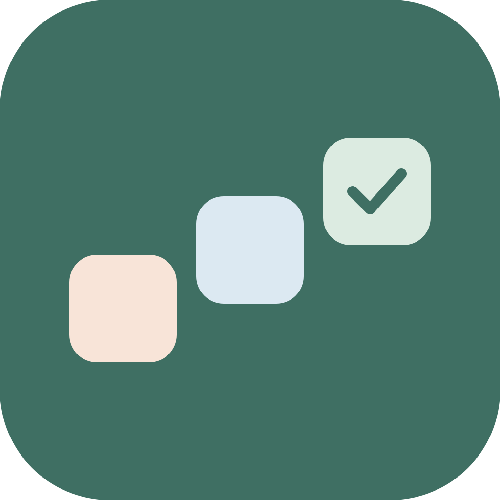
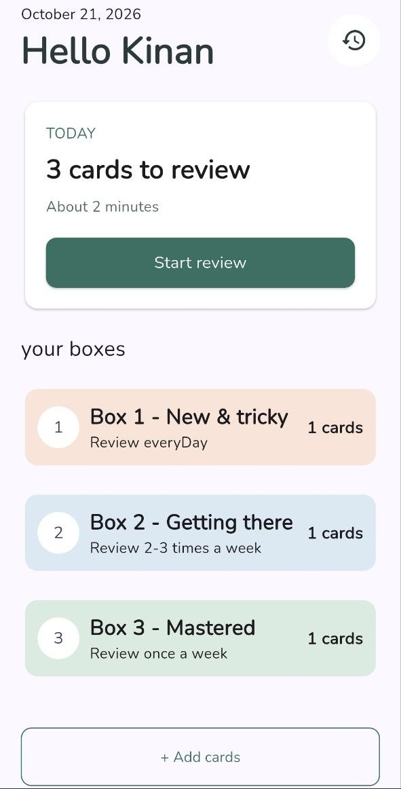
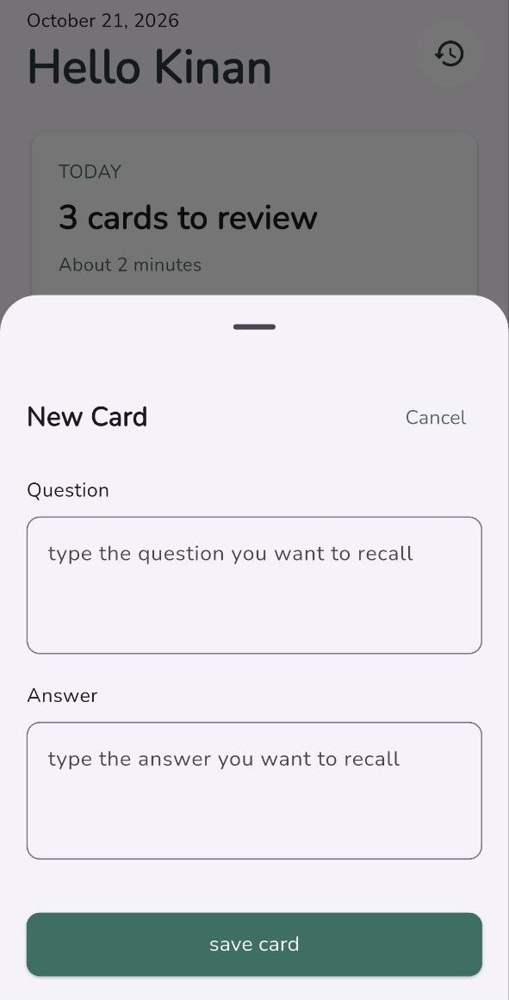
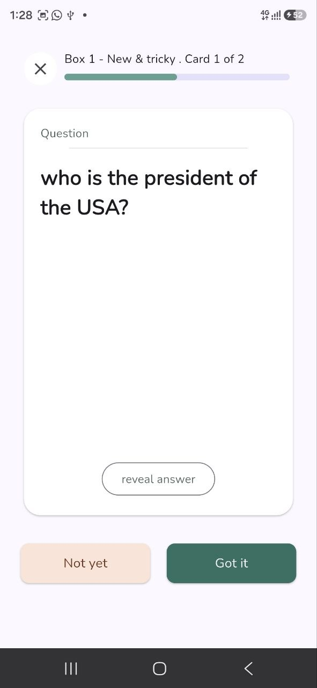
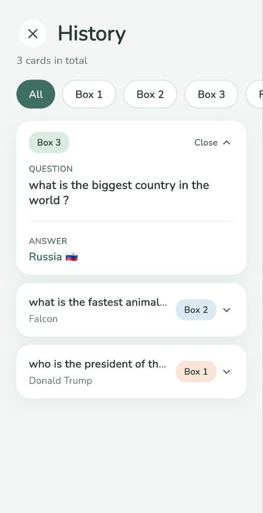

<div align="center">



# ThreeBox

**A calm flashcard app that builds lasting memory with active recall and the three-box Leitner system.**


</div>

<p align="center">
  
  
  
  
</p>

---

## Table of contents

- [Overview](#overview)
- [Why I built it](#why-i-built-it)
- [How it works](#how-it-works)
- [Features](#features)
- [Tech stack](#tech-stack)
- [Architecture](#architecture)
- [Design](#design)
- [Project structure](#project-structure)
- [Getting started](#getting-started)
- [Roadmap](#roadmap)
- [Author](#author)
- [License](#license)

## Overview

Re-reading notes feels productive, but **testing yourself** works far better. ThreeBox turns that into a simple daily habit: flip a card, answer from memory, and let the app schedule the next review.

I built it as a complete product, from the first design to the working app:

- **Product design:** a calm, minimal interface, designed screen by screen before any code was written.
- **Clean architecture:** a layered Flutter project with GetX for state, dependency injection and routing.
- **Focused scope:** one clear learning method, done well, with no feature clutter.

It is based on two proven study techniques:

- **Active recall:** retrieving information from memory instead of re-reading it.
- **Spaced repetition:** reviewing material at growing intervals using the Leitner system.

## Why I built it

I made ThreeBox for my younger brother. He is in his final year of school and had a long list of important questions to memorise before his exams. Re-reading his notes wasn't working, so I wanted to give him a simple way to practise recall every day, without a complicated app getting in the way.

That shaped every decision: the interface is calm and uncluttered, there is one main action per screen, and the app does the scheduling so he can focus on studying.

## How it works

Every flashcard lives in one of three boxes.

| Box | Contains | Review frequency |
| --- | --- | --- |
| **Box 1: New & tricky** | New cards and cards you got wrong | Every day |
| **Box 2: Getting there** | Cards you answered correctly once | 2–3 times a week |
| **Box 3: Mastered** | Cards you know well | Once a week or less |

```
        correct             correct              correct
 Box 1 ────────▶ Box 2 ────────▶ Box 3 ────────▶ Finished
   ▲                │               │
   └────────────────┴───────────────┘
                 wrong answer
```

- Answer **correctly** and the card moves up one box.
- Answer **wrong** and the card goes back to Box 1.
- A card that passes Box 3 is marked **Finished** and stays available in History.

## Features

- **Three-box review system** with daily, weekly and mastered schedules
- **Focused review sessions** with one card at a time and a progress bar
- **Reveal-then-grade flow:** tap "Not yet" or "Got it" after seeing the answer
- **History** with filters for All, Box 1, Box 2, Box 3 and Finished
- **Quick card creation** from the home screen
- **Calm interface** with no streak pressure and no clutter

## Tech stack

| Area | Technology |
| --- | --- |
| Framework | [Flutter](https://flutter.dev) (Dart 3) |
| State management | [GetX](https://pub.dev/packages/get) |
| Dependency injection | GetX bindings |
| Navigation | GetX named routes |
| Typography | [`google_fonts`](https://pub.dev/packages/google_fonts) (Nunito) |

## Architecture

ThreeBox separates presentation, logic, data and navigation, so each part is easy to read, change and test.

| Layer | Folder | Responsibility |
| --- | --- | --- |
| Views | `views/` | Screens and reusable widgets that react to controller state |
| Controllers | `controllers/` | State and business logic (`GetxController`) |
| Bindings | `bindings/` | Register each screen's controllers when its route opens |
| Models | `Models/` | Data classes such as `FlashCard` |
| Routes | `routes/` | Route names and pages |
| Core | `core/` | Shared theme and colors |

```
Route opens ─▶ Binding creates the controller ─▶ View reads controller state
                                                      │
                                   user taps ─▶ Controller updates state ─▶ View rebuilds
```

**Key decisions**

- **One binding per screen**, so a controller exists only while its screen needs it.
- **Small, reusable widgets.** The History screen, for example, is split into a header, a chip list and a card list instead of one large file.
- **One source for colors** in `core/theme/app_colors.dart`, so the look can change in one place.
- **Controllers hold the logic**, and views stay focused on layout.

## Design

I designed the interface first, then built it. The goal was a screen that feels quiet enough to study in.

- **Soft palette:** sage green as the main color, with muted peach, blue and green for the three boxes
- **Typography:** [Nunito](https://fonts.google.com/specimen/Nunito), a rounded and friendly sans-serif
- **Shape and space:** rounded corners, white cards, soft shadows and generous spacing
- **One main action per screen**, so it is always clear what to do next

| Role | Color | Hex |
| --- | --- | --- |
| Background |  | `#F3F6F4` |
| Surface |  | `#FFFFFF` |
| Text |  | `#2C3B37` |
| Primary |  | `#3F6F63` |
| Box 1 |  | `#F8E4D8` |
| Box 2 |  | `#DCE9F2` |
| Box 3 |  | `#DCEBE1` |

## Project structure

```
lib/
├── main.dart
├── assets/
│   └── icon/
│       ├── icon.png
│       └── icon.svg
├── bindings/
│   ├── history_binding.dart
│   ├── home_binding.dart
│   ├── initial_binding.dart
│   └── review_binding.dart
├── controllers/
│   ├── flashcard_controller.dart
│   ├── history_controller.dart
│   └── review_controller.dart
├── core/
│   └── theme/
│       └── app_colors.dart
├── Models/
│   ├── box-model.dart
│   └── flash_card.dart
├── routes/
│   ├── app_pages.dart
│   └── app_routes.dart
└── views/
    ├── screens/
    │   ├── history_page.dart
    │   ├── home_page.dart
    │   └── review_page.dart
    └── widgets/
        ├── add_card.dart
        ├── bottom_sheet.dart
        ├── box_card.dart
        ├── flash_card_widget.dart
        ├── primary_button.dart
        ├── start_card.dart
        └── history/
            ├── filter_chip_list.dart
            ├── filter_ship.dart
            ├── history_card.dart
            ├── history_card_list.dart
            └── history_header.dart
```

## Getting started

**Prerequisites:** [Flutter SDK](https://docs.flutter.dev/get-started/install) (Dart 3 or newer) and an emulator or physical device.

```bash
# Clone the repository
git clone https://github.com/<your-username>/<your-repository>.git
cd <your-repository>

# Install dependencies
flutter pub get

# Run the app
flutter run
```

<details>
<summary><b>Generate the launcher icon</b></summary>

<br />

The icon is stored at `lib/assets/icon/icon.png` (1024×1024). Add this to `pubspec.yaml`:

```yaml
dev_dependencies:
  flutter_launcher_icons: ^0.14.0

flutter_launcher_icons:
  android: true
  ios: true
  image_path: "lib/assets/icon/icon.png"
```

Then run:

```bash
dart run flutter_launcher_icons
```

</details>

## Roadmap

- [x] Three-box review flow
- [x] History with filters
- [x] Save cards on the device so they persist between sessions
- [x] Search in History
- [x] Card detail screen with full answer and review history
- [x] Review reminders
- [x] Decks and subjects
- [x] Import and export cards

## Author

**[Michel Jarjoura]**

[LinkedIn](https://linkedin.com/in/your-profile) · [GitHub](https://github.com/your-username) · [Email](micheljarjoura3@gmail.com)

If you like the project, a star is much appreciated.

## License

Distributed under the MIT License. See [`LICENSE`](LICENSE) for details.
